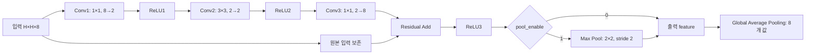

# 부록: CNN 모델 구성과 데이터 배치 방식

작성일: 2026-11-04  
대상: `tb_core`와 `embedded_controller`를 사용하는 현재 behavioral simulation 구성

## 1. 목적과 구현 범위

이 프로젝트는 ResNet 계열의 bottleneck 구조를 축소한 CNN 연산 모델을 대상으로, 고정소수점 연산 결과와 ready/valid 인터페이스의 동작을 검증한다. 채널을 `8 → 2 → 2 → 8`로 줄였다가 복원하는 세 개의 convolution과 identity residual 경로를 사용한다.

현재 모델은 학습된 분류 신경망 전체가 아니다. 이미지 데이터셋, 학습된 가중치, 분류기, softmax 및 분류 정확도 측정은 포함하지 않는다. 입력과 가중치는 고정 seed로 생성한 임의의 값이다. Batch Normalization과 bias 연산도 구현되어 있지 않다. 따라서 이 문서의 검증 결과는 연산 및 데이터 전달의 정확성을 설명하며, 학습 모델의 인식 정확도를 의미하지 않는다.

또한 `embedded_controller.v`와 `rtl_dummy`의 연산 블록은 task 기반의 시뮬레이션용 동작 모델이다. 실제 FPGA의 파이프라인, BRAM 배치, 메모리 대역폭, 합성 자원 및 최대 동작 주파수를 모델링한 구현은 아니다.

## 2. CNN 모델

### 2.1 연산 순서



세 convolution은 모두 stride 1이다. Conv2는 각 공간 축에 zero padding 1을 적용하여 입력과 같은 공간 크기를 유지한다. Conv1과 Conv3은 padding 0이다. 커널을 뒤집지 않고 저장된 순서대로 곱하므로, 수학적 의미에서는 일반적인 CNN 구현의 cross-correlation에 해당한다.

Residual Add는 Conv3 결과와 bottleneck의 원본 입력을 같은 좌표·채널끼리 더한다. 별도의 projection convolution은 없다. pooling은 residual 합산과 마지막 ReLU 이후에 적용되므로 residual의 두 입력 크기는 동일하다.

### 2.2 레이어별 크기와 가중치 수

배치 크기는 1이며, 아래 표에서는 배치 차원을 생략한다.

| 단계 | 연산 | 입력 크기 | 출력 크기 | 가중치 수 |
|---|---|---|---|---:|
| Conv1 | 1×1 convolution, stride 1 | H×H×8 | H×H×2 | 2×1×1×8 = 16 |
| ReLU1 | 음수 제거 | H×H×2 | H×H×2 | 0 |
| Conv2 | 3×3 convolution, stride 1, pad 1 | H×H×2 | H×H×2 | 2×3×3×2 = 36 |
| ReLU2 | 음수 제거 | H×H×2 | H×H×2 | 0 |
| Conv3 | 1×1 convolution, stride 1 | H×H×2 | H×H×8 | 8×1×1×2 = 16 |
| Residual | 원본 입력과 합산 | H×H×8 두 개 | H×H×8 | 0 |
| ReLU3 | 음수 제거 | H×H×8 | H×H×8 | 0 |
| Pool | 선택적 2×2 max pooling | H×H×8 | H/2×H/2×8 | 0 |
| GAP | 채널별 공간 평균 | 출력 feature | 8 | 0 |

한 케이스의 가중치는 총 68개이다. `output`은 추가 연산 레이어가 아니라, GAP에 들어가기 전 feature를 검증하기 위해 붙인 단계 이름이다. pooling이 없으면 ReLU3와 같고, 있으면 Pool과 같다. `data/output.txt` 역시 GAP 이전의 정답이며, GAP 결과는 별도의 `case*_gap.txt`에 저장한다.

### 2.3 두 테스트 케이스

| 항목 | case0 | case1 |
|---|---|---|
| 입력 크기 | 4×4×8 | 6×6×8 |
| 입력 원소 수 | 128 | 288 |
| pooling | 사용하지 않음 | 2×2, stride 2 |
| GAP 이전 출력 크기 | 4×4×8 | 3×3×8 |
| GAP 이전 출력 원소 수 | 128 | 72 |
| GAP 출력 원소 수 | 8 | 8 |
| 가중치 수 | 68 | 68 |

두 케이스는 같은 구조를 서로 다른 입력·가중치로 실행하는 독립적인 테스트이다. case0의 결과를 case1의 입력으로 연결하지 않는다.

## 3. 입력과 가중치 생성

`utiles/generate_reference.py`는 `numpy.random.default_rng(20261103)`을 사용한다. case0부터 case1까지 순서대로 난수를 소비한다.

| 데이터 | 생성 규칙 | 배열 크기 |
|---|---|---|
| 입력 | uniform(-1.5, 1.5) | H×H×8 |
| Conv1 가중치 | 평균 0, 표준편차 0.38의 정규분포 | 2×1×1×8 |
| Conv2 가중치 | 평균 0, 표준편차 0.30의 정규분포 | 2×3×3×2 |
| Conv3 가중치 | 평균 0, 표준편차 0.42의 정규분포 | 8×1×1×2 |

생성기는 동일한 실수 입력·가중치에서 출발해 두 종류의 정답을 계산한다.

- **실수 정답:** 양자화하지 않은 입력과 가중치를 사용한 float64 결과이다. convolution은 NumPy window와 `einsum`으로 계산한다.
- **정수 정답:** 입력과 가중치를 Q7.8로 양자화한 뒤, 중첩 반복문으로 계산한다. 각 연산의 반올림·포화 규칙은 HDL과 맞춘다.

입력과 정답 생성은 시뮬레이션 이전의 독립 작업이다. `behav_sim.bat`은 Python을 호출하거나 정답을 재생성하지 않는다.

## 4. 수치 형식

### 4.1 signed 16비트 Q7.8

이 프로젝트에서 Q7.8은 부호 1비트, 정수부 7비트, 소수부 8비트의 signed 16비트 고정소수점 형식이다.

```text
실제 값 = signed 정수 / 256
표현 범위 = -128 ~ 127.99609375
최소 간격 = 1/256 = 0.00390625
```

입력과 가중치는 `sign(x) × floor(abs(x) × 256 + 0.5)`로 양자화하고, 정수 범위 `[-32768, 32767]`로 포화시킨다. 정확히 절반인 값은 0에서 멀어지는 방향으로 반올림한다.

### 4.2 연산별 처리

| 연산 | 처리 규칙 |
|---|---|
| MAC | 두 Q7.8 값의 곱을 소수부 16비트인 값으로 누산한다. 내부 누산 변수는 signed 64비트이다. dot product 종료 시 256으로 나누어 반올림하고 16비트로 포화한다. |
| ReLU | signed 값이 음수이면 0, 나머지는 입력 그대로 출력한다. |
| Residual | main과 skip 정수를 확장하여 더하고 signed 16비트 범위로 포화한다. |
| Max Pool | window 내부의 signed 최댓값을 선택한다. 별도 반올림은 없다. |
| GAP | 채널별 정수 합계를 공간 원소 수로 나누어 반올림하고 16비트로 포화한다. |

MAC은 곱 하나마다 Q7.8로 잘라내지 않는다. 한 출력 원소를 위한 모든 곱을 더한 뒤 한 번 반올림한다. 또한 Conv3 결과를 먼저 포화시킨 후 Residual Add를 수행하므로, Conv3와 residual을 합친 뒤 한 번 포화하는 구현과는 수치 결과가 달라질 수 있다.

### 4.3 텍스트 파일 표현

정수 데이터는 한 줄에 16비트 2의 보수 값 하나를 4자리 hexadecimal로 기록한다. 한 줄의 토큰이 메모리의 한 원소에 대응하며, 바이트 단위로 나뉜 파일은 아니다.

| 파일 값 | signed 정수 | 실제 값 |
|---|---:|---:|
| `0100` | 256 | 1.0 |
| `ff00` | -256 | -1.0 |
| `0001` | 1 | 0.00390625 |
| `8000` | -32768 | -128.0 |

HDL은 `$readmemh`로 이를 읽는다. Python 검증기는 32768 이상인 값을 65536만큼 빼 signed 정수로 복원한다. `*_float.txt`는 hexadecimal이 아니라 실수 정답을 기록한 파일이다.

## 5. 저장 배열의 데이터 배치

### 5.1 feature: NHWC 순서

입력과 중간 feature는 NHWC 순서를 사용한다. 배치 크기가 1이므로 실제 1차원 인덱스는 다음과 같다.

```text
feature_index(y, x, c) = (y × W + x) × C + c
```

채널 `c`가 가장 빠르게 바뀌고, 그다음 `x`, 마지막으로 `y`가 바뀐다. 현재 컨트롤러는 정사각형 feature만 사용하므로 코드에서는 `W` 대신 `h`를 사용한다.

입력 채널이 8개일 때의 예시는 다음과 같다.

```text
index 0~7   : (y=0, x=0)의 c=0~7
index 8~15  : (y=0, x=1)의 c=0~7
index 16~23 : (y=0, x=2)의 c=0~7
...
다음 행의 시작 인덱스: W × 8
```

Conv1·Conv2 출력은 채널 수가 2이므로 픽셀 하나당 두 값이 연속한다. Conv3 이후에는 다시 픽셀 하나당 여덟 값이 연속한다. GAP 결과는 공간 차원 없이 채널 0부터 7까지의 순서이다.

### 5.2 kernel: O, KY, KX, I 순서

가중치 배열은 출력 채널 `O`, 커널 행 `KY`, 커널 열 `KX`, 입력 채널 `I` 순서로 저장한다. 가장 빠르게 바뀌는 축은 입력 채널이다.

```text
weight_index(oc, ky, kx, ic)
    = weight_base + ((oc × K + ky) × K + kx) × Cin + ic
```

한 케이스의 kernel 메모리는 Conv1, Conv2, Conv3 순서로 이어 붙인다.

| 레이어 | 케이스 내부 시작 인덱스 | 원소 수 | 내부 인덱스 범위 |
|---|---:|---:|---|
| Conv1 | 0 | 16 | 0~15 |
| Conv2 | 16 | 36 | 16~51 |
| Conv3 | 52 | 16 | 52~67 |

전체 kernel 배열에서 케이스의 시작은 `kernel_offset = case_id × 68`이다. 예를 들어 case1 Conv2의 시작은 `68 + 16 = 84`이다.

### 5.3 케이스를 연결한 파일

TB의 `data` 폴더에는 case0 다음 case1 순서로 연결한 파일이 있다. 인덱스는 모두 0부터 시작한다.

| 파일 | 전체 원소 수 | case0 시작 / 개수 | case1 시작 / 개수 |
|---|---:|---|---|
| `input.txt` | 416 | 0 / 128 | 128 / 288 |
| `kernel.txt` | 136 | 0 / 68 | 68 / 68 |
| `output.txt` | 200 | 0 / 128 | 128 / 72 |

TB는 이 파일들을 각각 `inputs[0:415]`, `weights[0:135]`, `outputs[0:199]`로 읽는다. `inputs`와 `weights`는 배열 포트로 컨트롤러에 전달한다. `outputs`는 TB의 정답 판정에만 사용하며 컨트롤러에는 전달하지 않는다.

## 6. 저장 순서에서 연산 입력 순서로의 변환

### 6.1 convolution 입력 배치

컨트롤러의 `convolution` task는 다음 순서로 반복한다.

```text
출력 y → 출력 x → 출력 채널 oc
    → 커널 행 ky → 커널 열 kx → 입력 채널 ic
```

앞의 세 반복문은 출력 원소 하나를 선택하고, 뒤의 세 반복문은 해당 출력의 dot product를 구성한다. 입력 좌표와 값은 다음과 같이 구한다.

```text
iy = y + ky - floor(K/2)
ix = x + kx - floor(K/2)

범위 안: activation = feature[(iy × h + ix) × Cin + ic]
범위 밖: activation = 0
```

padding용 큰 배열이나 전체 im2col 행렬을 별도로 만들지 않는다. 컨트롤러가 메모리를 순회하며 필요한 값을 선택하고, 경계 밖의 값은 0으로 치환하여 전송한다. padding 위치에서도 0과 해당 가중치를 MAC에 전달하므로, 경계 출력의 전송 개수도 내부 출력과 같다.

MAC의 `in_data` 포트 하나를 activation과 weight가 번갈아 사용한다.

```text
activation0(iteration=0) → weight0(iteration=1)
activation1(iteration=0) → weight1(iteration=1)
...
마지막 activation → 마지막 weight(iteration=1, in_last=1)
    → 출력 원소 하나
```

`in_last`는 한 레이어 전체의 종료가 아니라 **현재 dot product의 종료**를 뜻한다. 커널 행·열·입력 채널이 모두 마지막일 때 weight와 함께 1로 전달한다.

| 레이어 | 출력 하나당 곱셈 수 | 출력 하나당 입력 handshake 수 |
|---|---:|---:|
| Conv1 | 1×1×8 = 8 | 16 |
| Conv2 | 3×3×2 = 18 | 36 |
| Conv3 | 1×1×2 = 2 | 4 |

가중치는 kernel 메모리에 보존하지만, 공간 출력 위치가 달라질 때 동일한 가중치를 MAC에 다시 전송한다. 현재 인터페이스에는 MAC 내부의 가중치 캐시나 병렬 입력 채널이 없다.

### 6.2 ReLU와 residual

ReLU 입력은 `feature[0]`부터 유효 원소 수만큼 순차 전송한다. 입력 하나에 출력 하나가 대응한다. ReLU 모듈은 `in_last`를 연산에 사용하지 않는다.

Residual Add를 위해 컨트롤러는 케이스 시작 시 원본 입력을 `skip`에 복사한다. 각 인덱스 `t`에 대해 다음 두 입력을 보낸다.

```text
feature[t] (in_last=0) → skip[t] (in_last=1) → 합계 하나
```

입력 둘과 출력 하나가 같은 NHWC 좌표에 대응한다. Conv3 출력 채널이 입력과 같은 8개이고 convolution이 공간 크기를 유지하므로 별도 좌표 변환이나 projection이 필요하지 않다.

### 6.3 max pooling 입력 배치

pooling의 반복 순서는 `y(2씩 증가) → x(2씩 증가) → c → dy → dx`이다. 채널 하나의 window를 먼저 완성한 뒤 다음 채널로 이동한다.

```text
동일 채널 c에 대해:
(y, x) → (y, x+1) → (y+1, x) → (y+1, x+1)
                                           마지막 값에 in_last=1
```

네 값 중 최댓값 하나를 출력한다. 출력 순서는 `출력 y → 출력 x → c`이므로 결과도 NHWC이다. case1에서는 6×6×8의 288개 입력이 3×3×8의 72개 출력으로 바뀐다.

### 6.4 GAP 입력 배치

GAP는 feature의 NHWC 저장 순서를 그대로 전송하지 않는다. 반복 순서를 `채널 c → 공간 인덱스 t`로 바꾼다.

```text
c=0: feature[0], feature[8], feature[16], ...
c=1: feature[1], feature[9], feature[17], ...
...
c=7: feature[7], feature[15], feature[23], ...
```

전송 주소는 `feature[t × 8 + c]`이다. 채널 하나의 마지막 공간 값에서 `in_last=1`을 보낸다. 따라서 case0는 채널마다 16개, case1은 pooling 이후 채널마다 9개를 평균내고, 각각 8개 결과를 출력한다.

## 7. 컨트롤러와 TB의 역할 분리

### 7.1 컨트롤러의 상태

| 배열·상태 | 역할 |
|---|---|
| `feature[0:1023]` | 현재 레이어의 입력 또는 방금 완료한 레이어의 출력 |
| `skip[0:1023]` | 케이스의 원본 입력 보존 |
| `captured[0:4][0:1023]` | 연산 모듈별 실제 출력 수집 |
| `received[0:4]` | 연산 모듈별 누적 출력 개수 |

모듈 번호는 MAC=0, ReLU=1, Pool=2, Residual=3, GAP=4이다. `finish_layer`는 해당 모듈의 출력 개수가 목표에 도달할 때까지 기다린 뒤, 이번 레이어 구간만 `feature`의 시작 부분으로 복사한다. 이후 다음 레이어가 그 배열을 재사용한다.

`feature`의 실제 유효 길이는 레이어 크기로 결정된다. 배열의 나머지 원소를 매번 지우지는 않는다. 현재 테스트의 최대 feature 크기는 288개이며, 1024개라는 선언 크기는 시뮬레이션용 여유 공간이다. 이를 FPGA의 실제 메모리 사용량으로 해석해서는 안 된다.

### 7.2 단계 완료와 검증

컨트롤러는 단계 완료 시 아래 정보를 TB에 전달한다.

| 신호 | 의미 |
|---|---|
| `stage_valid` | 이번 단계의 정보를 확인할 수 있음 |
| `stage_id` | 단계 종류 |
| `stage_unit` | 출력을 낸 연산 모듈 번호 |
| `stage_start` | 해당 모듈의 누적 수신 배열에서 이번 단계의 시작 인덱스 |
| `stage_size` | 이번 단계의 출력 개수 |
| `stage_ready` | TB가 비교와 파일 저장을 마쳤다는 응답 |

| stage_id | 단계 | case0 원소 수 | case1 원소 수 |
|---:|---|---:|---:|
| 0 | conv1 | 32 | 72 |
| 1 | relu1 | 32 | 72 |
| 2 | conv2 | 32 | 72 |
| 3 | relu2 | 32 | 72 |
| 4 | conv3 | 128 | 288 |
| 5 | residual | 128 | 288 |
| 6 | relu3 | 128 | 288 |
| 7 | pool | 생략 | 72 |
| 8 | output | 128 | 72 |
| 9 | gap | 8 | 8 |

예를 들어 MAC의 case0 Conv1은 수신 배열의 시작 0에서 32개, Conv2는 시작 32에서 32개, Conv3는 시작 64에서 128개이다. 케이스 사이에 수신 카운터를 reset하지 않으므로 case1 Conv1의 시작은 192이다.

TB도 연산 모듈의 실제 출력 포트를 직접 감시하여 별도의 `captured`와 `received`를 관리한다. 컨트롤러 내부 배열을 읽어서 정답을 판정하지 않는다. 반대로 컨트롤러도 TB의 expected 데이터나 정답 파일을 읽지 않는다. `feature` 갱신과 정답 비교는 분리되어 있다.

케이스 실행은 TB가 `h`, 입력·가중치 offset, `pool_enable`을 설정하고 `start`를 올려 시작한다. 컨트롤러는 GAP 단계의 TB 확인까지 마친 뒤 `done`을 올린다. 단계 확인과 케이스 시작·종료 절차는 시뮬레이션 task 모델의 제어 인터페이스이며, 합성된 파이프라인 제어기로 검증된 것은 아니다.

### 7.3 연산 포트의 handshake

연산 모듈의 입력과 출력은 상승 에지에서 각각 `valid && ready`일 때 전달된다. 컨트롤러는 하강 에지에서 입력을 설정하고 수신될 때까지 유지한다. TB는 출력 ready에 의사난수 backpressure를 주며, 출력이 막혔을 때 `out_valid`와 `out_data`가 유지되는지 검사한다.

모듈마다 `in_last`의 의미가 다르므로, 일괄적으로 프레임 종료 신호로 해석해서는 안 된다.

| 모듈 | `in_last=1`의 의미 |
|---|---|
| MAC | 현재 dot product의 마지막 weight |
| ReLU | 사용하지 않음 |
| Pool | 현재 채널의 window 마지막 값 |
| Residual | main에 더할 skip 값 |
| GAP | 현재 채널의 마지막 공간 값 |

## 8. 전송량과 결과 검증

### 8.1 두 케이스의 연산 포트 전송량

아래 수치는 기본 산술·reset 검사 이후 카운터를 초기화하고 두 CNN 케이스를 실행한 구간의 합계이다. stage 확인 신호와 `output`의 재검증은 연산 모듈의 추가 입력·출력을 만들지 않는다.

| 연산 모듈 | 입력 handshake 수 | 출력 handshake 수 | 산출 근거 |
|---|---:|---:|---|
| MAC | 7072 | 624 | 곱셈 3536회에 대해 activation·weight 각각 전송 |
| ReLU | 624 | 624 | 두 케이스의 ReLU1·2·3 합계 |
| Pool | 288 | 72 | case1의 2×2 window 네 입력당 한 출력 |
| Residual | 832 | 416 | main·skip 두 입력당 한 출력 |
| GAP | 200 | 16 | case0 128개와 case1 72개를 채널별 평균 |

MAC의 곱셈 수는 한 케이스당 `H² × (16 + 36 + 16) = 68H²`이다. 두 케이스의 합계는 `68 × (4² + 6²) = 3536`회이다. 이 수치는 padding 위치의 0과 가중치의 곱도 포함한 현재 컨트롤러의 실행 횟수이다.

### 8.2 검증 기준과 확인된 결과

HDL TB는 단계별 정수 정답과 실제 출력을 비교하고, 최종 출력은 연결된 `data/output.txt`와도 비교한다. 별도의 Python 검증은 정수값의 정확 일치와 실수 정답 대비 SNR > 30 dB를 검사한다.

```text
SNR[dB] = 10 × log10(Σ reference_float² / Σ(reference_float - actual_integer/256)²)
```

실수 정답은 양자화 이전 입력과 가중치로 계산하므로 SNR에는 입력·가중치·중간 출력의 양자화 효과가 포함된다. 정수 정답과 정확히 일치해도 실수 정답과의 오차는 존재할 수 있다.

현재 저장된 실제 HDL 출력에 대한 검증 결과는 다음과 같다.

| 항목 | case0 | case1 |
|---|---:|---:|
| output SNR | 50.03 dB | 57.70 dB |
| GAP SNR | 49.56 dB | 59.15 dB |
| 모든 단계 중 최소 SNR | 41.16 dB | 43.47 dB |
| 정수 정답과 불일치한 값 | 0 | 0 |

추가로 signed 포화의 양쪽 경계, 양수·음수의 절반값 반올림, 음수 max pooling, ReLU 경계 및 연산 블록에 미완료 상태가 남은 상황의 reset을 검사한다. 이 reset 검사는 CNN 케이스를 시작하기 전의 직접 입력 시험이며, 실행 중인 CNN 케이스 전체를 reset 후 자동 재시작하는 검증은 아니다.

현재 컨트롤러 분리 구성의 시뮬레이션 완료 시각은 232660 ns이다. 입력 bubble, backpressure와 TB의 단계 확인 대기가 포함된 시간이며, 실제 FPGA의 CNN 처리량을 추정하는 수치로 사용할 수 없다.

## 9. 파일 구성과 실행

```text
프로젝트 루트/
├─ behav_sim.bat
├─ appendix.md
├─ bottleneck/
│  ├─ rtl_dummy/                  # MAC, ReLU, Pool, Residual, GAP
│  └─ bench/tb_core/
│     ├─ tb_core.v               # 테스트·정답 비교·독립 출력 감시
│     ├─ embedded_controller.v   # 입력 배치·레이어 제어·feature 관리
│     ├─ tb_core.f               # TB 폴더 기준 HDL 컴파일 목록
│     ├─ data/                   # 연결된 input, kernel, output.txt
│     └─ .log/                   # 컴파일 결과·로그·실제 출력·results.json
└─ utiles/
   ├─ generate_reference.py
   ├─ check_results.py
   ├─ reference_manifest.json
   └─ data/                      # case별 정수·실수 정답
```

`.f`는 HDL 컴파일 목록이다. `.txt`의 등록이나 `$readmemh` 검색 경로를 관리하지 않는다. XSim은 TB의 `.log`에서 실행하므로 TB 입력은 `../data/input.txt`, 단계별 정답은 `../../../../utiles/data/case*_*.txt`로 읽는다. 실제 출력은 현재 작업 폴더에 `case<번호>_<단계>_actual.txt`로 기록한다.

프로젝트 루트에서의 실행 순서는 다음과 같다. Python 단계에는 NumPy가 필요하고, 시뮬레이션 단계에는 Vivado 도구가 PATH에 있어야 한다.

```powershell
# 1. 사전 입력·정답 생성: 데이터가 이미 있으면 생략 가능
python .\utiles\generate_reference.py

# 2. HDL 컴파일, elaboration, behavioral simulation
.\behav_sim.bat tb_core

# 3. 실제 HDL 출력의 정수 일치 및 실수 기준 SNR 검사
python .\utiles\check_results.py
```

## 10. 확장 시 수정할 항목

현재 구현은 정사각형 입력, 고정 채널 `8→2→2→8`, batch 1, identity skip, 짝수 공간 크기의 선택적 pooling을 전제로 한다. `h`나 `pool_enable`만 바꾼다고 임의 CNN을 지원하지는 않는다.

모델을 확장할 때는 생성기의 tensor shape, controller의 채널 수·순회·kernel offset, 포트와 내부 배열 크기, TB의 케이스 설정·출력 개수·파일 offset을 함께 수정해야 한다. 직사각형 입력에는 별도의 높이·너비가 필요하고, 입력·출력 채널이나 공간 크기가 다른 residual에는 skip 변환 경로가 필요하다. FPGA 구현으로 발전시키려면 현재 배열 순회를 실제 메모리 주소 생성, line buffer, 가중치 재사용 및 파이프라인 제어로 구체화해야 한다.

## 11. 작성 근거

본 문서는 외부 모델의 일반적인 구성을 그대로 가정하지 않고 다음 구현을 기준으로 작성했다.

- [embedded_controller.v](bottleneck/bench/tb_core/embedded_controller.v): 연산 순서, 배열 인덱스, 입력 직렬화, 단계 제어
- [tb_core.v](bottleneck/bench/tb_core/tb_core.v): 데이터 로딩, 케이스 설정, 독립 scoreboard 및 검증
- [generate_reference.py](utiles/generate_reference.py): 난수 생성, tensor shape, 양자화 및 정답 파일 배치
- [check_results.py](utiles/check_results.py): 정수 일치와 SNR 판정
- [reference_manifest.json](utiles/reference_manifest.json): 케이스별 크기와 생성 기준
- [rtl_dummy](bottleneck/rtl_dummy): 각 연산의 수치 규칙과 ready/valid 동작
- 실행 결과: `bottleneck/bench/tb_core/.log/simulate.log`, `results.json`
