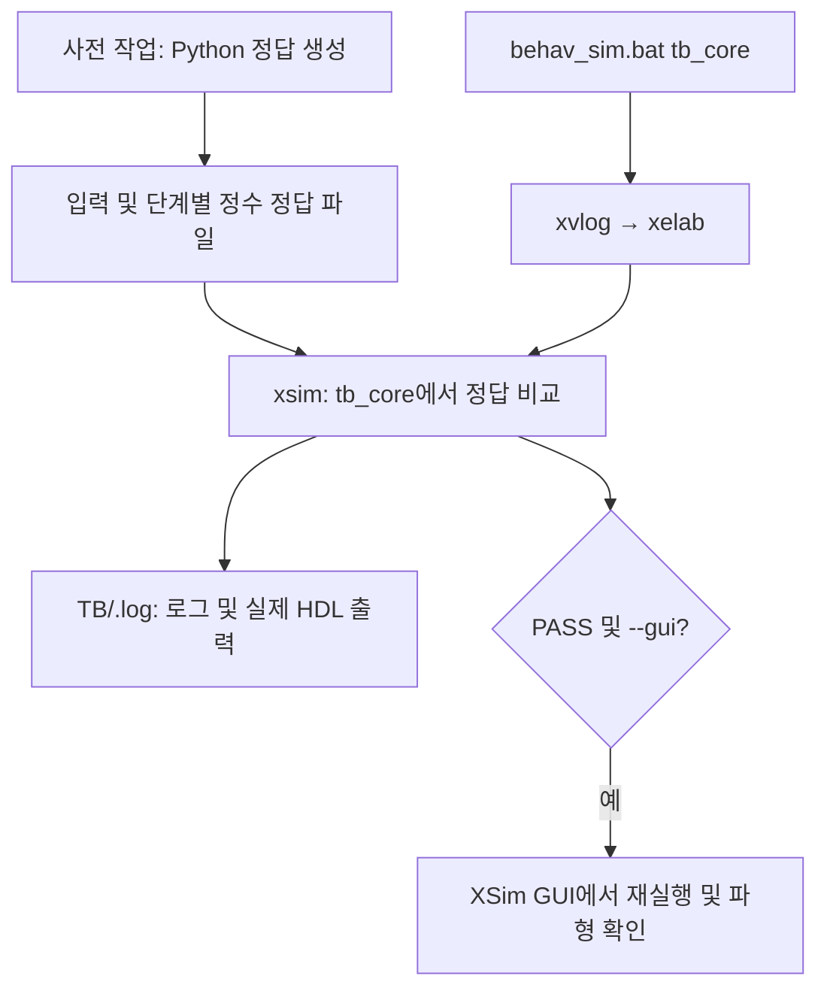
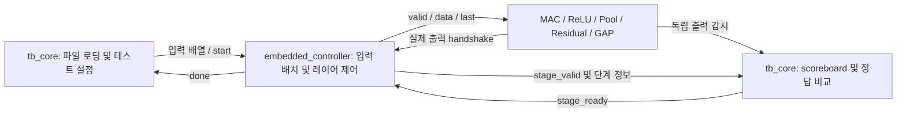
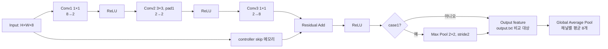

# Bottleneck dummy 검증

ResNet bottleneck 두 개를 single-MAC 동작 모델로 검증하는 학습용 시뮬레이션입니다.
MAC, ReLU, pooling, residual, GAP의 외부 인터페이스는 ready/valid handshake로 동작하고,
내부 계산은 task로 수행합니다. 데이터 형식은 signed 16bit Q7.8입니다.
정답 생성·검증 도구와 참조 데이터는 `utiles`, 실행 로그·파형은 각 TB의 `.log`에 저장합니다.
아래 경로는 별도 설명이 없으면 프로젝트 루트 기준입니다.

## 실행

### 파일 구성

- `utiles/generate_reference.py`: 입력·가중치와 정수·실수 정답 생성
- `utiles/check_results.py`: 실제 HDL 출력의 정수값 비교와 SNR 계산
- `utiles/reference_manifest.json`: 테스트 구성, 데이터 형식, 단계별 SNR
- `utiles/data/`: 단계별 정수 정답과 float64 정답
- `bottleneck/bench/tb_core/data/`: TB가 읽는 input.txt, kernel.txt, output.txt
- `bottleneck/bench/tb_core/.log/`: 컴파일 결과, 파형, 로그, 실제 출력, 검증 보고서

### 사전 작업: 입력과 정답 준비

Python과 numpy가 설치된 환경에서 프로젝트 루트 기준으로 실행합니다.
이미 데이터가 준비되어 있다면 다시 생성하지 않아도 됩니다.

```powershell
python .\utiles\generate_reference.py
```

이 작업은 `utiles/data`, `utiles/reference_manifest.json`과 TB의 `data` 파일을 갱신합니다.
고정 seed=20261103을 사용합니다. `behav_sim.bat`에서는 Python을 호출하지 않습니다.

### XSim behavioral simulation

Windows CMD와 Vivado의 `xvlog.bat`, `xelab.bat`, `xsim.bat`이 PATH에 있어야 합니다.
필요하면 사용하는 Vivado 설치의 `settings64.bat`으로 환경을 설정합니다.

```powershell
.\behav_sim.bat tb_core
.\behav_sim.bat tb_core --gui
```

컴파일 목록은 `bottleneck/bench/tb_core/tb_core.f`에 지정합니다.
한 줄에 HDL 파일 경로 하나를 쓰며, 상대경로는 TB 폴더 기준입니다.
빈 줄과 `#`로 시작하는 주석은 무시합니다. 데이터 txt는 목록에 넣지 않습니다.
현재 TB 때문에 HDL은 SystemVerilog 모드로 컴파일합니다.

배치는 `xvlog → xelab → xsim`을 직접 실행하고, 진행 내용을 터미널에 출력합니다.
TB는 실제 출력과 사전 생성한 정수 정답을 비교하고 handshake 및 산술 경계도 검사합니다.
`--gui`를 지정하면 배치 시뮬레이션 후 GUI에서 다시 실행합니다.

작업 폴더는 `bottleneck/bench/tb_core/.log`입니다.
`compile.log`, `elaborate.log`, `simulate.log`에서 각 단계 결과를 확인합니다.
GUI 로그는 `xsim_gui.log`에 저장됩니다. 최종 검증 성공 표기는 `[ PASS ] ALL TESTS PASSED`입니다.

### 독립 Python 검증

시뮬레이션을 완료한 뒤 필요할 때 별도로 실행합니다.

```powershell
python .\utiles\check_results.py
```

현재 TB의 `.log/case*_actual.txt`를 `utiles/data`의 정수·실수 정답과 비교합니다.
정수값의 정확 일치와 실수 기준 SNR > 30 dB를 검사하고, `.log/results.json`에 결과를 저장합니다.

## 대략적인 블록다이어그램

### 검증 실행 흐름



### 실제 TB와 dummy 연결

MAC, ReLU, pooling, residual, GAP은 각각 하나의 인스턴스를 레이어별로 재사용합니다.
`embedded_controller.v`는 시뮬레이션용 task 모델이며, 합성 가능한 하드웨어 제어기는 아닙니다.

| embedded_controller | tb_core |
|---|---|
| feature·skip 메모리 관리 | 입력·가중치·정답 파일 로딩 |
| convolution 순회와 zero padding | 테스트 케이스 설정과 start 구동 |
| pooling window·GAP 입력 배치 | backpressure와 출력 안정성 검사 |
| 입력 handshake와 실제 출력 수집 | 독립 scoreboard의 수치·개수 검사 |
| 다음 레이어 feature 갱신 | 단계별 정답 비교와 실제 출력 파일 저장 |



TB와 컨트롤러는 서로의 내부 메모리를 직접 참조하지 않습니다.
컨트롤러는 단계별 `stage_id`, 출력 모듈 번호·시작 인덱스·개수를 알리고,
TB가 직접 관측한 출력으로 검증한 뒤 `stage_ready`를 반환하면 다음 레이어로 진행합니다.
기본 산술·reset 테스트는 공개 시뮬레이션 task인 `controller.send_word`로 입력합니다.
케이스 실행 중에는 `start`와 `done`을 사용합니다.

### bottleneck의 논리 연산 순서

다음 그림의 Conv 세 개는 물리적으로 MAC 세 개가 아니라, 같은 MAC을 세 레이어에 걸쳐 재사용하는 순서입니다.



MAC은 activation과 weight를 한 쌍씩 받아 곱셈·누산합니다. 입력 채널이나 출력 필터 병렬화는 없습니다.
논문의 블록 구성을 참고한 기능 검증 모델이며, 실제 core의 처리 지연·처리량이나 논문의 병렬 하드웨어를 재현하지는 않습니다.

## 두 입력 구성

둘 다 batch=1, NHWC 메모리, 채널 8→2→2→8, identity skip입니다.

```text
input ─┬─ conv1(1x1) → ReLU → conv2(3x3,pad1) → ReLU → conv3(1x1) ─┐
       └────────────────────── identity skip ────────────────────────┤
                                                                  add → ReLU → [max pool] → output → GAP
```

| 구분 | 입력 | bottleneck 출력 | 선택 max pool | 최종 feature 출력 | GAP |
|---|---|---|---|---|---|
| case0 | 4×4×8 | 4×4×8 | 없음 | 4×4×8 (128개) | 8개 |
| case1 | 6×6×8 | 6×6×8 | 2×2, stride2 | 3×3×8 (72개) | 8개 |

pooling은 두 번째 bottleneck의 마지막 ReLU 뒤에 붙였습니다. skip과 main의 크기를 유지하는 학습용 구성입니다.
GAP은 두 경우 모두 별도로 검증합니다. `output.txt`는 GAP 전 feature 출력입니다.
학습된 모델이 아닌 seed=20261103의 임의 입력과 가중치이며, bias=0, BN은 identity로 생략했습니다.
따라서 실제 ResNet의 정확도나 논문의 성능을 재현하는 검증은 아닙니다.
참고 논문의 streaming compute, ReLU, pooling, residual, GAP 구성을 기초 구조의 방향으로 참고했습니다.

## 수치 규칙

사용자 확인에 따라 IEEE FP16 대신 **signed 16bit Q7.8**로 통일했습니다.

- 값 = signed word / 256, 범위 -128 ~ 127.99609375, LSB=1/256.
- 입력과 가중치 양자화, MAC 결과, residual, GAP: 최근접 반올림, 정확히 절반이면 0에서 멀어지는 방향.
- 모듈 출력에서 signed 16bit 범위로 포화합니다.
- MAC의 내부 누산만 64bit Q*.16으로 확장합니다. 각 곱을 Q7.8로 자르지 않고 dot product 전체가 끝난 뒤 한 번 반올림합니다.
- max pool과 ReLU는 원래 Q7.8 값을 그대로 선택합니다.
- `.txt`는 한 줄당 16bit 2의 보수 hex 하나이며 `$readmemh`로 읽습니다.

## 기존 포트 사용 규칙

포트를 추가하지 않았습니다. `out_valid`, `out_data`만 procedural assignment를 위해 `wire`에서 `reg`로 바꿨습니다.
모든 입력과 출력은 상승 에지에서 `valid && ready`인 경우에만 전달됩니다.
출력 대기 중 `out_valid`, `out_data`를 유지하고, 공간이 없으면 `in_ready=0`으로 입력을 막습니다.
`nrst=0`은 비동기 reset이며 누산 중인 값과 미수신 출력도 버립니다.

| 모듈 | 입력 직렬화와 완료 조건 |
|---|---|
| mac | activation(`iteration=0`) 다음 weight(`iteration=1`)를 보냅니다. 마지막 weight의 `in_last=1`이 dot product를 끝내고 출력 1개를 만듭니다. |
| relu | 입력 하나당 출력 하나. 프레임 처리가 없어 `in_last`는 사용하지 않습니다. |
| residual | main 값(`in_last=0`) 다음 skip 값(`in_last=1`)으로 합계 하나를 만듭니다. |
| pooling | 한 채널의 window 값들을 보내고 마지막 값에 `in_last=1`. window 최대값 하나를 만듭니다. |
| general_average_pooling | 한 채널의 공간 값들을 보내고 마지막 값에 `in_last=1`. 평균 하나를 만듭니다. |

`iteration`은 기존에 정의된 의미가 없어서 위와 같이 operand 선택 신호로 정의했습니다.
출력에는 `out_last`가 없으므로 컨트롤러가 레이어별 예상 개수를 세고, TB가 독립적으로 검증합니다.
모듈 연산은 각각 `compute` task에서 수행하며 실제 MAC 파이프라인이나 합성 가능한 core 설계가 아닙니다.

## TB와 메모리

컨트롤러는 `feature`, `skip` 및 수신용 `captured` 메모리를 관리합니다.
TB가 파일에서 읽은 입력·가중치를 배열 포트로 전달하며, 연산 모듈은 streaming 포트만 사용합니다.
TB의 별도 `captured` 메모리는 정답 비교용 scoreboard이고, 다음 레이어의 입력에는 사용하지 않습니다.
따라서 다음 레이어 데이터 갱신은 정답 판정과 분리되어 있습니다.

컨트롤러의 `convolution` task는 NHWC feature를 output y,x,channel 순서로 순회하고,
kernel y,x,input channel 순서로 MAC 입력을 배치합니다. zero padding도 컨트롤러가 담당합니다.
kernel 메모리 순서는 O,KY,KX,I입니다. pooling은 채널별 2×2 window,
GAP은 채널별 공간 스트림을 만들어 전송합니다.

기존 bench 파일의 순서는 case0 다음 case1입니다.

| 파일 | case0 offset/count | case1 offset/count |
|---|---|---|
| input.txt | 0 / 128 | 128 / 288 |
| kernel.txt | 0 / 68 | 68 / 68 |
| output.txt | 0 / 128 | 128 / 72 |

case당 kernel 68개는 conv1 16개, conv2 36개, conv3 16개 순서입니다.
`data/case*`에는 중간 정수 레퍼런스와 실수 레퍼런스를 따로 둡니다.

## 검증 결과

`bottleneck/bench/tb_core/.log/simulate.log`의 `ALL TESTS PASSED`를 확인합니다. 아래 SNR 수치는 Python 검증 결과입니다. `behav_sim.bat`은 SNR을 계산하지 않으며, `utiles/check_results.py`를 별도로 실행하면 `.log/results.json`이 갱신됩니다.
Python 실수 모델은 numpy window/einsum, 정수 모델은 별도 중첩 loop로 convolution을 계산합니다.
실수 모델은 입력과 가중치를 양자화하기 전 float64 값에서 출발하므로 입력·가중치·중간 출력 양자화 오차까지 SNR에 포함됩니다.
`check_results.py`는 **시뮬레이터가 실제로 기록한 값**으로 모든 단계의 정확 일치와 실수 기준 SNR > 30dB를 확인합니다.

SNR = 10 log10(sum(reference²) / sum((reference - actual/256)²)).

| 결과 | case0 | case1 |
|---|---:|---:|
| 최종 feature SNR | 50.03 dB | 57.70 dB |
| GAP SNR | 49.56 dB | 59.15 dB |
| 모든 중간 단계의 최소 SNR | 41.16 dB | 43.47 dB |
| 정수 레퍼런스와 다른 값 | 0 | 0 |

추가로 signed 포화 양쪽 경계, 양수·음수 tie 반올림, 음수 max pool, ReLU 경계,
MAC/pool/residual/GAP 중간 상태와 ReLU 미수신 출력이 있는 상태의 reset을 검증합니다.
재현 가능한 의사난수 backpressure 및 입력 bubble을 주며, 대기 중 출력 안정성과 전체 출력 개수도 검사합니다.

| 모듈 | 입력 전달 수 | 출력 전달 수 | 출력 stall 사이클 | 입력 대기 사이클 |
|---|---:|---:|---:|---:|
| MAC | 7072 | 624 | 1161 | 646 |
| ReLU | 624 | 624 | 1340 | 970 |
| Pool | 288 | 72 | 133 | 72 |
| Residual | 832 | 416 | 1057 | 750 |
| GAP | 200 | 16 | 41 | 18 |

컨트롤러 분리 후 시뮬레이션 완료 시간은 232660ns입니다. 단계 확인 handshake 때문에 이전 구성과 stall 집계·완료 시각이 달라지지만, 모든 단계의 실제 출력 파일은 동일합니다. task 연산으로 계산 지연을 모델링하지 않았으므로 이 시간에서 실제 core 처리량을 추정하면 안 됩니다.
